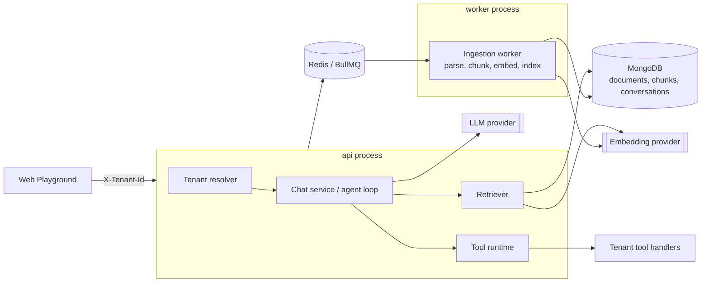

# agent-skeleton-kit

A multi-tenant RAG and tool-calling agent skeleton. One shared engine runs many isolated, domain-specific AI copilots. To create a new copilot you add a directory with a YAML config, knowledge documents, and tool handlers. You do not change the engine.

Built for the **Skeleton Crew** category of Kiroween 2026, with Kiro specs, steering, and hooks.

[](LICENSE)

> **Status: design complete, implementation starting.** The specs in [`.kiro/specs/`](.kiro/specs) are finished and the build follows [`tasks.md`](.kiro/specs/core-skeleton/tasks.md). Sections marked *(target)* describe the intended behavior and do not run yet. This README is updated as tasks complete.

## Why

Every production AI agent needs the same plumbing: document ingestion, chunking, embeddings, tenant data isolation, and function-calling orchestration. This kit provides that plumbing once. The domain lives in config and files.

## What you get

- **Strict multi-tenant isolation.** Knowledge, system prompts, tools, and conversations are separated per `tenant_id`, enforced in the database layer and the tool runtime.
- **Async RAG ingestion.** Markdown and PDF are parsed, chunked, embedded, and indexed by a Redis (BullMQ) worker into MongoDB Vector Search. Re-indexing swaps versions atomically, so answers stay correct during updates.
- **Declarative tool calling.** Tools are declared per tenant with JSON Schema. Arguments are validated before a handler runs, and a tenant can only call its own tools.
- **Web Playground.** A chat UI with a tenant switcher that shows citations, tool calls with arguments and results, and ingestion status.
- **Provider-agnostic.** LLM and embeddings use ports with an OpenAI-compatible adapter. Change `LLM_BASE_URL` and `LLM_MODEL` to switch providers.

## Two example tenants

| Tenant | Knowledge | Tools |
|---|---|---|
| [`ops-onboarding-copilot`](examples/ops-onboarding-copilot) | Engineering and HR policies, IT troubleshooting | `create_it_ticket(title, priority)` |
| [`ecommerce-order-concierge`](examples/ecommerce-order-concierge) | Product catalog, return policy, shipping FAQ | `check_order_status(order_id)`, `request_return(order_id, reason)` |

Both run side by side on the same core. The second tenant is added with zero changes under `packages/core`, and `npm run check:zero-core` *(target)* verifies that automatically.

## Quick start *(target)*

Requirements: Docker with Compose, and an API key for an OpenAI-compatible LLM provider.

```bash
cp .env.example .env      # set LLM_API_KEY (and optionally LLM_BASE_URL, LLM_MODEL)
docker compose up --build
```

Open http://localhost:3000, pick a tenant in the dropdown, and chat. The stack starts MongoDB (Atlas local image), Redis, the API with the playground, and the ingestion worker. Knowledge documents are ingested automatically on first start.

## Architecture



Core code follows Clean Architecture: `domain` (types and ports), `application` (use cases), `infrastructure` (adapters), `interfaces` (HTTP, CLI, playground). Dependencies point inward, and a dependency check enforces it. Details are in the [design](.kiro/specs/core-skeleton/design.md).

## How isolation works

Isolation is enforced in layers, so one mistake cannot expose another tenant's data.

1. The tenant resolver turns the request header into a frozen tenant context. Unknown tenants get a 404 and no data access.
2. Repositories require that context and add `tenantId` to every query and vector search internally.
3. Retrieval filters on `tenantId` and the active version, then drops any foreign result and logs it.
4. The tools sent to the model come only from the current tenant's config, and each tool call is checked against that allowlist before execution.
5. Tenant identity, session identity, and file paths never come from model output.
6. Conversations are keyed by tenant and session.

Automated tests cover each of these cases. The full rules are in [`tenant-isolation.md`](.kiro/steering/tenant-isolation.md).

## Add your own tenant

1. Create `examples/<tenant-id>/` (the directory name equals the tenant id).
2. Write `tenant.yaml`:

   ```yaml
   id: my-tenant
   displayName: My Tenant
   description: What this copilot does.
   systemPrompt: |
     Role, scope, and when to use each tool.
   retrieval: { topK: 5, minScore: 0.6 }
   chunking:  { maxTokens: 400, overlap: 50 }
   tools:
     - name: lookup_thing
       description: When to call this tool, written for the model.
       handler: ./tools/lookup-thing
       parameters:
         type: object
         required: [id]
         additionalProperties: false
         properties:
           id: { type: string }
   ```

3. Put Markdown or PDF files in `knowledge/`.
4. Write each handler:

   ```ts
   import type { ToolHandler } from "@agent-skeleton/core";

   const handler: ToolHandler<{ id: string }> = async (args, ctx) => {
     return { ok: true, id: args.id };
   };
   export default handler;
   ```

5. Run `npm run validate-tenant -- examples/my-tenant` *(target)*, then restart the stack. The tenant appears in the playground.

Conventions are in [`tenant-plugin-conventions.md`](.kiro/steering/tenant-plugin-conventions.md). Handlers run in the same process as the core, so only run tenant code you trust.

## Tech stack

Node.js 22, TypeScript (strict), Fastify, Zod, Ajv, BullMQ and Redis, MongoDB with `$vectorSearch`, pino, Vitest, Docker Compose.

## How Kiro was used

This repository was planned and built with Kiro's spec-driven workflow. Everything is in [`.kiro/`](.kiro):

- **Specs** ([`.kiro/specs/`](.kiro/specs)): requirements (EARS), design, and tasks for the core engine and for each example tenant.
- **Steering** ([`.kiro/steering/`](.kiro/steering)): standing rules for the tech stack, tenant isolation, architecture boundaries, tenant conventions, and testing. Some are always loaded, others load when matching files are open.
- **Hooks** ([`.kiro/hooks/`](.kiro/hooks)): guards that block architecture violations and accidental `.kiro` ignoring, plus prompts that trigger tenant validation, isolation review, and post-task verification.

See the [`.kiro/README.md`](.kiro/README.md) for a map.

## Roadmap

- MCP tool source, so tenants can connect external tools without custom handlers
- Streaming responses (SSE)
- Per-tenant token usage telemetry
- Authentication and role-based access control (replacing the `X-Tenant-Id` header)
- Local model adapter (Ollama)

## License

[MIT](LICENSE)
